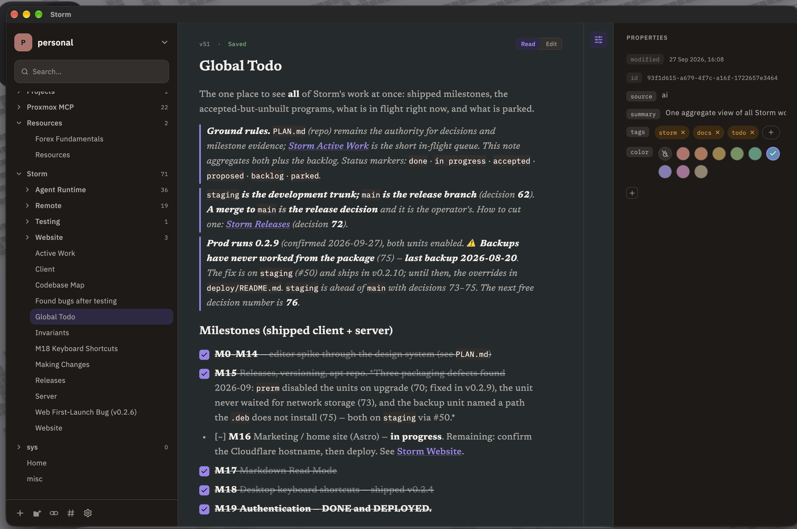
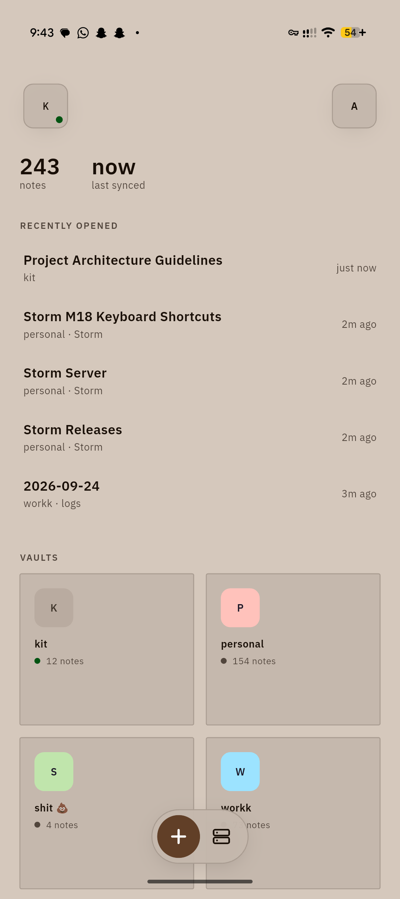
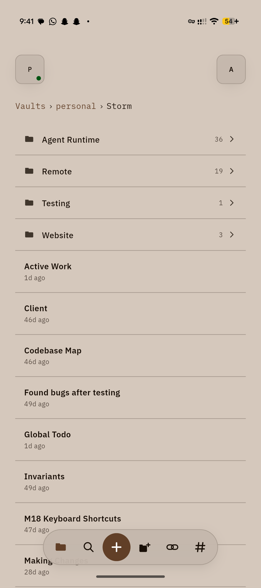
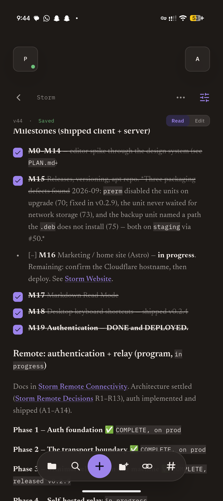
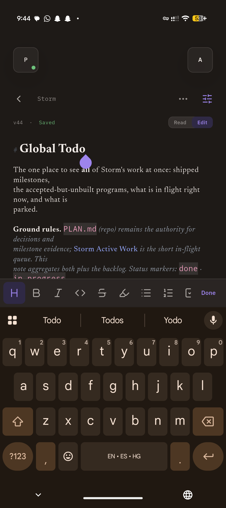
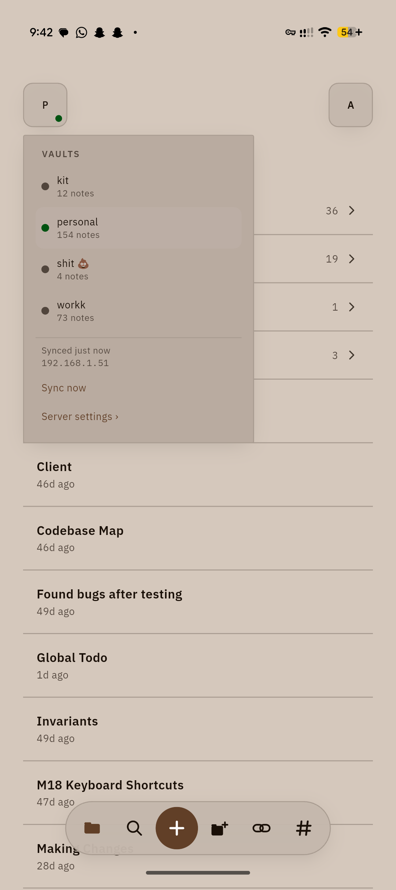
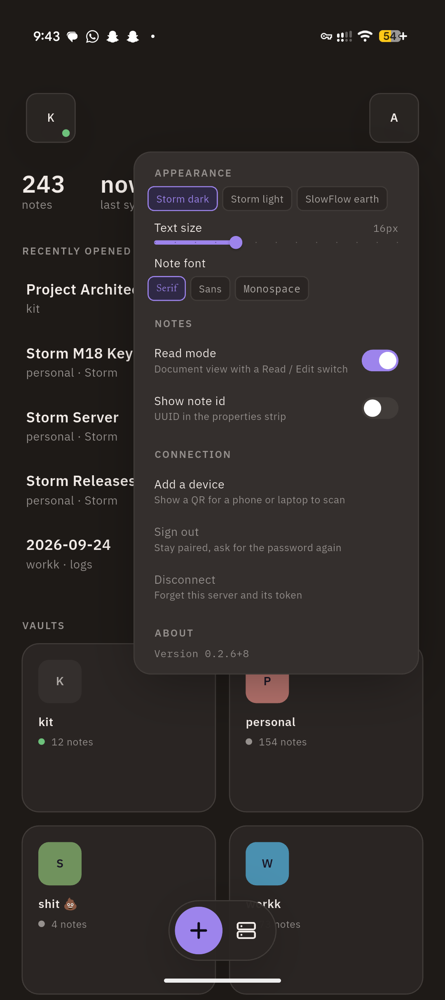
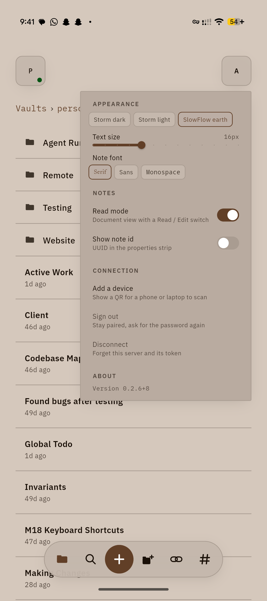
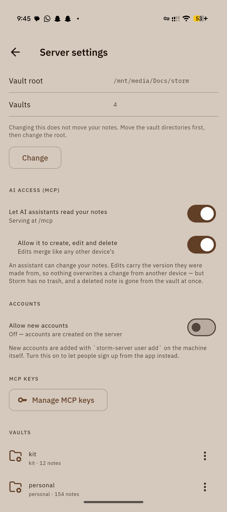

# Storm

Self-hosted, Markdown-native knowledge system. A Rust sync server owns the
canonical vaults on infrastructure you control; Flutter clients on macOS,
Windows, Linux, Android and the web keep pace, offline included. The same knowledge is available
to AI agents through MCP, and an optional runtime host runs coding agents —
Claude Code, Codex, OpenCode, Cursor, Command Code, a shell — in a workspace
with a terminal you drive from the app, and installs and updates those agents
for you. An optional relay reaches the server from outside your network
without opening a port.

> **Your knowledge. On your infrastructure.**

Site: [storm.dewansh.space](https://storm.dewansh.space) ·
Docs: [storm.dewansh.space/docs](https://storm.dewansh.space/docs/) ·
Download: [storm.dewansh.space/download](https://storm.dewansh.space/download) ·
Releases: [GitHub Releases](https://github.com/dewanshDT/Storm/releases)

```
┌──── clients (one Dart codebase) ────┐      ┌── AI agents ──┐
│  macOS · Windows · Linux            │      │  MCP clients  │
│  Android · Web                      │      └───────┬───────┘
│  editor · cache · outbox · sync     │              │
│  Notes | Agents | Integrations      │              │
└──────┬───────────────────┬──────────┘              │
  REST + WebSocket     via storm-relay          MCP (/mcp)
  (LAN)                (optional, SRP v1)            │
┌──────┴───────────────────┬─────────────────────────┴──┐
│  storm-server (Rust, axum)        ▲                    │
│  3-way merge · FTS5 · watcher     │ dials out          │
│  pairing + sessions · Agent Mgr   │                    │
└──────┬───────────────────┬───────┴──────────┬─────────┘
  vaults/*.md           state/          storm-runtime
  plain markdown        registry ·       PTY · workspaces
                        indexes ·        claude-code · codex ·
                        auth.db ·        opencode · shell
                        agent.db
```

Notes stay ordinary `.md` files under a storage root you control. Storm’s own
state lives in a sibling `state/` directory — never inside the vaults.

## Screenshots

The macOS client in the wide-screen layout: vault tree, a note in read mode,
and its typed properties.



The Android client, in the SlowFlow earth and Storm dark themes.

<table>
  <tr>
    <td align="center"><br><sub>Dashboard</sub></td>
    <td align="center"><br><sub>Folders</sub></td>
    <td align="center"><br><sub>Read mode</sub></td>
    <td align="center"><br><sub>Edit mode</sub></td>
  </tr>
  <tr>
    <td align="center"><br><sub>Vault switcher</sub></td>
    <td align="center"><br><sub>Storm dark</sub></td>
    <td align="center"><br><sub>SlowFlow earth</sub></td>
    <td align="center"><br><sub>Server settings</sub></td>
  </tr>
</table>

## Install

One command, on Linux or macOS — an interactive installer that sets up any
part of Storm on this machine: the server and app, a Runtime Host for agents,
or everything, with your phone paired over the local network and the runtime
enrolled for you. On Linux the server and Runtime Host need Debian or Ubuntu;
the desktop app installs on any distribution:

```sh
curl -fsSL https://dewanshdt.github.io/Storm/install.sh | sh
```

It shows its plan (every `sudo` step included) before changing anything, and
re-running it is how you upgrade, check status, pair a device, enroll a
runtime or uninstall (your notes are always kept). Scripted:
`sh install.sh --yes --server --app`, `--runtime`, `--everything`,
`--dry-run`; `sh install.sh --help` lists the rest. **MCP only** (`--mcp`)
puts just `storm-runtime` on a laptop's PATH for an AI app's `mcp-connect`
(below).

### By hand (server on Debian / Ubuntu)

```sh
curl -fsSL https://dewanshdt.github.io/Storm/install.sh | sudo sh   # apt repo + storm-server only
sudo storm-server up
sudo storm-server status
```

On macOS by hand: download `storm-server-<v>-macos-universal.tar.gz` from the
release and run `./storm-server up` as yourself — a LaunchAgent with your
notes in `~/Storm`.

On **Windows**, in PowerShell (as administrator for the Runtime Host):

```powershell
irm https://dewanshdt.github.io/Storm/install.ps1 | iex
```

It installs the server, the Runtime Host, the Storm app, or any of them
together. The app goes into `%LOCALAPPDATA%\Programs\Storm\App` with a
Start-menu entry, no administrator needed (`-App`). The server runs as you at
logon, with no console window and your notes in `%USERPROFILE%\Storm`; the
Runtime Host is the `StormRuntime` service under its own virtual account. By
hand, `storm-server-windows-x86_64.zip` gives `.\storm-server.exe up`, and
`storm-runtime-windows-x86_64.zip` gives `.\storm-runtime.exe install`, and
`storm-app-windows-x86_64.zip` is the app: unzip it and run `storm.exe`
(decisions 99, 125; [`deploy/README.md`](deploy/README.md#windows)).

That URL is the **apt repository** root (not the marketing site). `up` creates
the `storm` user and data root (`/srv/storm`), writes `/etc/storm/storm.env`
and enables the service; the web client is served from the same port.

### Pair the first device

There is no shared token. Storm is single-user: one account, with per-device
sessions and MCP keys as the only credentials. While the server has no account,
`pair` prints a single-use pairing URI — `--qr` also draws it as a code for a
phone to scan:

```sh
sudo -u storm storm-server pair --state /srv/storm/state --qr
```

You set the account's password on that first device. Add more devices from
the app (Settings › Devices & access › Add a device); reset a forgotten
password with `storm-server passwd`. Details:
[`deploy/README.md`](deploy/README.md#the-account).

### Update

```sh
sudo apt update
sudo apt install --only-upgrade storm-server
sudo systemctl restart storm-server
sudo storm-server status
```

Clients (macOS zip, Windows zip, Linux `.deb` or tarball, Android APK, web UI)
are on [Releases](https://github.com/dewanshDT/Storm/releases) and the
[Download page](https://storm.dewansh.space/download).

### Runtime Hosts (optional)

`storm-runtime` runs agents on a machine for one Storm Server — the server's
own box, or another. It is a separate package in the same apt repository, the
server needs no inbound route to it, and it can read no vault: its own account
is never in the server's group.

```sh
sudo apt install storm-runtime
sudo -u storm-runtime mkdir /var/lib/storm-runtime/workspaces/myproject
# In the app: Settings › Hosts & default agent › Enroll a host, then paste the string:
sudo -u storm-runtime storm-runtime enroll
sudo systemctl enable --now storm-runtime
sudo -u storm-runtime storm-runtime check        # proves the whole path
```

Providers are `claude-code` (default), `opencode`, `codex`, `cursor`,
`command-code` and `shell`; Cursor and Command Code run as terminals, with no
notes or integrations yet. Workspaces and limits live in
`/etc/storm-runtime/runtime.toml`, and a root outside `/var/lib/storm-runtime`
needs a `ReadWritePaths` drop-in on the unit. Log the agent CLIs in once as
`storm-runtime` (`claude`, `opencode auth login`; Codex from a Shell session
on the host, into Storm's own Codex home:
`CODEX_HOME=/var/lib/storm-runtime/agents/codex codex login --device-auth`,
after a `mkdir -p` of that directory) — the unit's `HOME` is its own, not
yours. A session gets your integrations beside the MCP servers its agent
loads by itself: yours, its
[plugins'](https://storm.dewansh.space/docs/agents/plugins/), a project's
under the agent's own prompts; `agent_mcp = "storm-only"` in `runtime.toml`
gives a host Storm's servers alone.

**Settings › Agents** (beta) installs, updates and removes the agent CLIs on
a Linux or macOS host, into the host's own folder, checked against each
vendor's published checksum; `agent_install = "off"` in `runtime.toml` turns
that off. The launcher picks a model and a permission mode (Manual by
default; never one that turns the agent's prompts off), and **New
workspace…** makes a folder on the host. On Linux the host checks that every
call to a session's Storm tools comes from inside that session.

The package also ships `storm-runtime-isolation`, a root helper that runs
each session as its own system user in its own sandbox and network. It is
**experimental and disabled**: nothing changes until `sudo
storm-runtime-isolation on`, and the docs say to leave it off for now. Agent
spawning — a session starting, messaging and ending agents of its own, which
never prompt you and send their refusals to it — is offered only on a host
where that isolation is on and verified, so it is off everywhere by default.
Setup and the package's guarantees:
[`deploy/README.md`](deploy/README.md#runtime-hosts-agent-runtime) and
[the hosts docs](https://storm.dewansh.space/docs/agents/hosts/). A Runtime
Host connects to its server directly; the app reaches agent sessions through
the relay like everything else.

### Relay (optional)

`storm-relay` lets clients reach a server from outside its network: the server
dials out to the relay, so nothing is port-forwarded. The app races the
server's address and its relays, and uses whichever answers first. It is a
separate package in the same apt repository and nothing depends on it. The
relay holds no vault data and authenticates no one — a client's credential rides
inside the tunnel to the origin server, which checks it exactly as it would on
the LAN. It stores nothing, but until end-to-end encryption it can read the
traffic it carries, so run your own or use one you trust. Setup,
TLS and key bindings: [`deploy/README.md`](deploy/README.md#relay-optional);
wire spec: [`docs/srp-v1.md`](docs/srp-v1.md).

## Claude login sync (optional)

Storm can keep **your own** Claude subscription login and give it to the
Runtime Hosts you choose, so you sign in once instead of on every machine.

How it works: you run `claude setup-token` in a terminal outside Storm,
approve it in your browser, and paste the token into **Settings ▸ Claude
login**. Storm stores it encrypted on your Storm server. When a Claude Code
session starts on a host you have ticked, Storm hands the token to that
session. Claude Code then talks to Anthropic directly; Storm never sees your
prompts or Anthropic's replies. No host gets the token until you tick it.

**This is for one person, on their own machines, for their own work.**
Storm has a single user. Do not use this feature to share a Claude account,
to give other people access to your plan, or on machines you do not control.

**You are responsible for following Anthropic's terms.** Anthropic's
documentation says third-party developers "may not collect, store, or
intermediate Claude.ai credentials or session tokens". Storm stores your
token at your request, on your server. If you are not comfortable with that
risk to your account, don't turn this on: log in on each host instead (see
`deploy/README.md`).

Know what you are turning on:

- Every agent session on a ticked host can read the token.
- It is one token for all ticked hosts, valid for a year. Revoking it signs
  out every host at once.
- Your Storm server and its backups hold the token, encrypted, next to the
  key that opens it. Protect them like the token itself.
- Removing it in Storm stops new sessions from getting it. It does not
  revoke it, and sessions that are already running keep it until they end.

To revoke the token, go to your Claude account settings on claude.ai and
remove it there, then end any running sessions on ticked hosts. Then remove
it in **Settings ▸ Claude login**. To renew it before it expires, mint a new
token, use **Replace token**, and revoke the old one.

## Layout

| Path | What |
|---|---|
| [`apps/server`](apps/server/README.md) | Rust sync server — REST, WebSocket, MCP, auth, agent manager |
| [`apps/runtime`](apps/runtime) | `storm-runtime`, the Agent Runtime Host — PTY, providers, workspaces, agent installs (standalone crate, no workspace); `isolation/` is the per-session isolation root helper |
| [`apps/relay`](apps/relay) | `storm-relay`, the SRP v1 relay (standalone crate, no workspace) |
| [`apps/client`](apps/client/README.md) | Flutter app — macOS, Windows, Linux, Android, web |
| [`apps/www`](apps/www/README.md) | Website and docs (Astro + Starlight) → [storm.dewansh.space](https://storm.dewansh.space); the docs' pages are [`docs/site/`](docs/site) |
| [`deploy/`](deploy/README.md) | systemd units, apt bootstrap, backup, relay setup |
| [`docs/`](docs) | Design briefs, editor findings, the relay spec and its test vectors |

## Development

Requires Rust and Flutter. Point the server at a directory that **contains**
vaults (`VAULT_ROOT`), not at a single vault:

```sh
make dry-run VAULT_ROOT=~/vaults-copy   # report only — writes nothing
make server  VAULT_ROOT=~/vaults-copy   # http://127.0.0.1:8484
make client                             # or: make web / make serve-web
make www-dev                            # marketing site locally
```

Pair a client with the dev server from `apps/server`:
`cargo run -- pair --state ../../.dev/state --addr http://127.0.0.1:8484`.
`make help` lists every target.

## Testing

```sh
make check        # fmt-check + clippy + analyze + every unit suite
make test-live    # starts servers, runs the integration suites, tears down
```

Unit suites (server, relay, runtime, client) need nothing running. Live suites
drive the real client against a real server — sync, MCP, agent runtime and auth
each have their own; the runtime suite stands up its own server and host.

## MCP

When enabled, the server exposes Storm over Streamable HTTP at `/mcp`: eleven
read tools (vaults, search, notes, related notes, tags, recents, history,
versions, and scripts from the kit vault) always, plus five write tools
(create / update / delete note, create / update script) in read-write mode.
Off by default and switched at runtime from **Server ▸ AI access**; agents
authenticate with MCP keys minted in the app. Updates carry a `base_version`
into the same three-way merge the clients use, and a deleted note goes to the
vault's Trash for 30 days. See
[`apps/server/README.md`](apps/server/README.md#mcp).

An agent in a Storm session gets the same tools through the MCP Gateway, plus
`session_context`, with differences. With a write vault, `delete_note` and
`delete_folder` each wait for the person to Approve in the app, every time.
A Claude Code session no agent started has `request_permission_mode` to ask
for Auto. Where
spawning is on (above), the session gets `start_agent`, `list_agents`,
`agent_status`, `list_children`, `wait_agent`, `send_message`, `end_agent`
and `read_output`, and the agents it starts get `report_result` and
`read_messages` and never the delete tools. No tool lists, restores or
empties the Trash.

**Connecting an AI app: `storm-runtime mcp-connect`** (since v0.10.0). A
stdio adapter the AI app starts itself. It dials the server's LAN address first and falls back
to the server's relays, so one config works at home and away, and before it
sends the key anywhere it checks the server answers to the pinned public key.
The key comes from `STORM_MCP_KEY` (or `--key-file`), never an argument. When
it cannot get through, the client sees a JSON-RPC error carrying a
`storm_error` code rather than a hang. Making a key under **Settings ▸ Devices
& access** shows both lines, filled in for your server:

```sh
claude mcp add storm -e STORM_MCP_KEY=stk_… -- \
  storm-runtime mcp-connect --server srv_… --pk <server key> \
    --addr http://192.168.1.20:8484 --relay wss://relay.example.net
```

```json
{"mcpServers": {"storm": {"command": "storm-runtime",
  "args": ["mcp-connect", "--server", "srv_…", "--pk", "…",
           "--addr", "http://192.168.1.20:8484", "--relay", "wss://relay.example.net"],
  "env": {"STORM_MCP_KEY": "stk_…"}}}}
```

The raw HTTP entry (`"type": "http"`, `http://<host>:<port>/mcp`, the key as a
Bearer token) still works on the LAN, with no adapter and no identity check.

## Status

M0–M16 and M18–M28 are done; the newest release is on
[GitHub Releases](https://github.com/dewanshDT/Storm/releases/latest). That
covers auth (pairing by QR or, on your network, by password; sessions; MCP
keys — the shared token is gone) and a single account (decision 82); the Agent
Runtime, with Runtime Hosts on Linux, macOS and Windows and agent sessions
(Claude Code, Codex, OpenCode) in a terminal you can resume, each keeping
its own MCP servers beside your integrations, grouped into crews, with the
agent CLIs installed and updated from the app; agent deletes that wait for
your Approve, and a Trash in every vault; the MCP Gateway's integrations, each scoped to the
hosts you choose and signed in with your own app where a service needs one;
a Claude login you set once in the app and share with the
hosts you tick; the desktop app on macOS, Windows and Linux; Storm v2's activity rail; the interactive installer; and the
relay, which you can run yourself (a Cloudflare Worker relay is deployed for
testing). The website and its docs are at
[storm.dewansh.space](https://storm.dewansh.space) (M27). M17 (Markdown read
mode) is in progress. Per-session isolation and agent spawning are built and
ship turned off while they are tested on real hosts.

Milestone status and the decision log are kept in the maintainer's notes, not
in this repo. License: [MIT](LICENSE).
